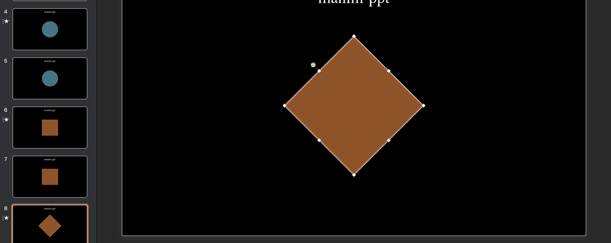

# manim-ppt

[](https://github.com/udiram/manim-ppt/actions/workflows/ci.yml)


Turn [Manim](https://www.manim.community/) animations into **native PowerPoint slides**: real, editable shapes animated with PowerPoint's own **Morph** transition. No video anywhere in the deck.


*[`examples/demo.py`](examples/demo.py), recorded straight from a PowerPoint slideshow.*

## Why

The usual way to get Manim into a talk is to render video clips and paste them onto slides. That works, but:

- clips are pixels, so they blur on a big projector,
- you can't touch them: no recoloring for a light theme, no nudging an element, no reusing a shape,
- every clip carries its own background, which fights your slide design,
- decks get heavy, and playback depends on codecs.

manim-ppt records the *state* of your scene at keyframes instead, and writes each mobject as a PowerPoint object that keeps its identity from slide to slide. PowerPoint's Morph transition does the animating.

And it tries hard to make those objects ones PowerPoint users recognise:



*`Rotate(square, PI / 4)` arrives as an actual Rectangle rotated by 45°, not as a diamond-shaped drawing.*

| In Manim | In PowerPoint |
|---|---|
| `Square`, `Rectangle`, `RoundedRectangle` | Rectangle / Rounded Rectangle (with its corner radius) |
| `Circle`, `Ellipse`, `Dot` | Oval |
| `Triangle`, any 3-corner polygon | Triangle |
| `Line`, axes, ticks, arrow shafts | Line |
| rotation | the shape's rotation, with a rotation handle |
| `Text`, `MathTex`, `Axes`, `Arrow`… | one **group** per mobject, named `Text 1`, `Axes 1`… |
| everything else | a freeform built from the same cubic Béziers Manim uses |
| fill, stroke, opacity, gradients | fill, line, transparency, gradient fill |
| `ImageMobject` | Picture |
| `next_slide(notes=…, section=…)` | speaker notes, sections |

## Install

```bash
pip install manim-ppt
```

or the latest from GitHub:

```bash
pip install git+https://github.com/udiram/manim-ppt
```

You need a working Manim Community install (`manim>=0.19`, Python 3.10+). `MathTex`/`Tex` need LaTeX, exactly as they do in Manim.

## Quick start

### Any scene, no code changes

```bash
manim-ppt scene.py MyScene
```

That writes `MyScene.pptx`. The scene does not have to know about manim-ppt at all, and no video is rendered, so this takes seconds. Useful flags:

```bash
manim-ppt scene.py MyScene -o talk/intro.pptx   # choose the output file
manim-ppt scene.py --all -o decks/              # every scene in the file
manim-ppt scene.py MyScene --template talk.pptx # build on your own deck (see below)
manim-ppt scene.py MyScene --open               # open it when done
manim-ppt --help
```

### Or as part of the scene

Change `Scene` to `PPTScene`. Nothing else changes, and a normal `manim` run now writes the deck next to the video.

```python
from manim import *
from manim_ppt import PPTScene


class Demo(PPTScene):
    def construct(self):
        title = Text("manim-ppt", font_size=72)
        self.play(Write(title))
        self.play(title.animate.scale(0.5).to_edge(UP))

        circle = Circle(radius=1.5, color=BLUE, fill_opacity=0.6)
        self.play(GrowFromCenter(circle))
        self.play(Transform(circle, Square(side_length=3, color=ORANGE, fill_opacity=0.6)))
        self.play(Rotate(circle, angle=PI / 2))
```

```bash
manim -ql demo.py Demo
# -> media/videos/.../Demo.mp4   (as usual)
# -> media/pptx/Demo.pptx        (new)
```

For other scene types, put the mixin first: `class Zoom(PPTMixin, MovingCameraScene): ...`

Open the `.pptx` in PowerPoint and start the slideshow. More in [`examples/`](examples).

## Controlling the slide flow

**Click mode (the default).** Each `self.play(...)` waits for a click, like a build in PowerPoint. `self.wait()` is ignored.

**Marker mode.** Call `self.next_slide()` anywhere and the deck switches to [Manim-Slides](https://github.com/jeertmans/manim-slides)-style markers. Everything between two `next_slide()` calls plays on a single click, and `self.wait(t)` becomes a timed pause.

```python
class Lecture(PPTScene):
    def construct(self):
        self.next_slide(notes="Introduce the function.", section="Setup")
        self.play(Create(axes))
        self.wait(0.5)  # a timed pause
        self.play(Create(graph), FadeIn(label))
        self.next_slide(notes="Slide a point along it.", section="Along the curve")
        ...
```

`notes` become speaker notes. `section` starts a named PowerPoint section, which keeps a long deck navigable in the thumbnail pane and slide sorter.

## Using your own deck and theme

```python
class Intro(PPTScene):
    ppt_template = "my_talk.pptx"
```

or `manim-ppt scene.py Intro --template my_talk.pptx -o my_talk_animated.pptx`.

The template's theme, slide size, layouts and background are used; the slides it already contains are kept, and the animation is appended after them. Your original file is not modified. By default the scene's background color is *not* painted when a template is given, so the animation sits on your slide design (pass `ppt_background = True` / `--background` to paint it anyway). If the template isn't 16:9, the scene is centered and scaled to fit.

Without a template you get a clean 16:9 deck whose slide master carries the scene's background, so the whole deck can be restyled from one place and slides you add by hand match.

## Options

| class attribute | CLI flag | default | meaning |
|---|---|---|---|
| `ppt_output` | `-o` | `media/pptx/<Scene>.pptx` (CLI: `./<Scene>.pptx`) | where to write the deck |
| `ppt_mode` | `--mode` | `"auto"` | `"click"`, `"markers"`, or `"auto"` (markers if you ever call `next_slide()`) |
| `ppt_template` | `-t` | – | a `.pptx` to build on |
| `ppt_background` | `--background` / `--no-background` | on without a template | paint the scene background onto the slides |
| `ppt_native_shapes` | `--freeform` | on | presets and real rotation; off gives freeforms only |
| `ppt_group` | `--no-groups` | on | one group per compound mobject |
| `ppt_max_samples` | `--max-samples` | `12` | cap on Morph steps for one `play()` |
| `ppt_updater_samples_per_second` | | `4` | Morph steps per second while updaters run |
| `ppt_auto_export` | | on | write the deck when the render finishes |

You can also call `self.ppt_export("somewhere.pptx")` yourself, or force the number of Morph steps for one call with `self.play(anim, ppt_samples=8)`.

## How it works

1. **Keyframes.** `PPTScene` hooks into `play()`. It snapshots every visible mobject when the animation begins, at any intermediate sample points, and when it ends. Each snapshot becomes a slide.
2. **Identity.** Every mobject gets one name for the whole deck (`Circle 1`, `Text 2`…), prefixed with `!!` so that Morph pairs it with itself on the next slide. When `ReplacementTransform`, `TransformMatchingTex` and friends swap one mobject for another, the newcomer inherits the name. Parts that are rebuilt on every frame (`always_redraw`, `DecimalNumber`) keep theirs too.
3. **The right form for each transition.** Morph is picky. It moves, scales and rotates presets and groups flawlessly, but mangles complex freeforms as they change size, and it can only bend one outline into another when both are freeforms. So a circle stays a native Oval while it moves around, becomes a freeform with Manim's own Bézier points for the one transition that turns it into a square, and is a native Rectangle from then on. Where a slide needs one form coming in and another going out, it is written twice with an instant, invisible cut in between.
4. **Timing.** Slides get a Morph transition (with a fade fallback for viewers that lack Morph) timed to the animation's `run_time`. Sub-steps advance automatically; plays (or markers) wait for a click.

### Keyframe sampling

Morph moves things in straight lines, so one step per `play()` is right for most animations: moves, scales, fades, recolors, `Transform`. Intermediate steps are added automatically where a straight line would be wrong:

| animation | Morph steps |
|---|---|
| `Rotate`, `Transform(path_arc=...)`, `Rotating` | one per 45° |
| `Indicate` & other `there_and_back` animations | 2 |
| `Wiggle` | 8 |
| `MoveAlongPath`, `Homotopy` | 6 |
| `LaggedStart` / `AnimationGroup(lag_ratio>0)` | up to 6 |
| `AddTextLetterByLetter` | up to 8 |
| `Succession` | sum of its parts |
| anything while updaters run (`always_redraw`, `ValueTracker`) | 4 per second |

### Entrances and exits

- `FadeIn(m, shift=UP)`, `FadeOut(m, scale=0.5)`: the shape is left on the neighbouring slide fully transparent, so Morph moves or scales it while it fades.
- `GrowFromCenter`, `GrowArrow`, `ShrinkToCenter`…: the shape grows out of (or shrinks into) an invisible miniature of itself.
- `Create` on a straight line draws it from its start. `Write`, `DrawBorderThenFill` and `Create` on other shapes become clean fades: Morph cannot trace a stroke.

## Limitations

- **It is an approximation, not a frame-perfect copy.** Morph has its own ease-in/ease-out on every step, so a `play()` split into several steps moves with a slight pulse. Pen-tracing effects become fades.
- **Bending one outline into another** (`Transform(circle, square)`) is done by Morph's own geometry blend. The start and end are exact; the in-between can differ from Manim's and may show faint artifacts on translucent fills.
- **Text and LaTeX are vector outlines**, not editable text boxes. They stay pixel-exact and need no fonts, but you can't retype them in PowerPoint.
- **More slides than clicks.** Every Morph step is a slide, as is every instant cut, so slide numbers count them. Stepping *backwards* in a slideshow lands on auto-advancing slides and plays forward again.
- **Needs PowerPoint 2019 / Microsoft 365** to play Morph. Playback was verified in PowerPoint for Mac; Keynote and Google Slides open the deck but show a fade or a cut between slides.
- 3D scenes are captured as the camera projects them, without lighting or sheen. Background strokes are ignored.
- Only the Cairo renderer is supported.

## Development

```bash
uv venv && uv pip install -e ".[dev]"
pytest
ruff check . && ruff format --check .
```

`manim_ppt/model.py`, `geometry.py` and `writer.py` don't import Manim, so the PowerPoint side can be tested and reused on its own. See [CONTRIBUTING.md](CONTRIBUTING.md).

## License

MIT
