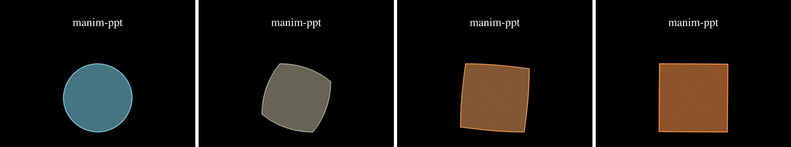
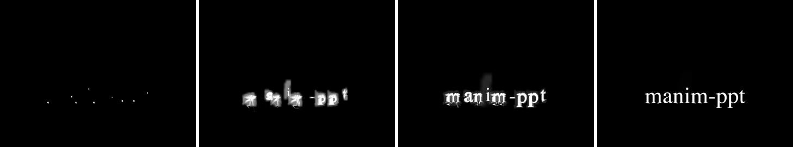

# manim-ppt

Export [Manim](https://www.manim.community/) animations as **native, editable PowerPoint slides**: real vector shapes animated with PowerPoint's **Morph** transition. The output contains no embedded video.


*`Transform(circle, square)` playing in PowerPoint's slideshow. These are live Morph frames, not video.*

## Why

Other tools ([manim-slides](https://github.com/jeertmans/manim-slides), [manim-pptx](https://github.com/RythenGlyth/manim-pptx)) already get Manim into PowerPoint, but they render your scene to video and paste the clips into slides. That works, but in practice:

- the clips are rasterized, so they blur on a 4K projector,
- you can't touch them: no recoloring for a light theme, no fixing a typo, no nudging an element,
- each clip has its own background, which fights your slide design,
- decks get big, and playback depends on codecs.

manim-ppt captures the *state* of your scene at keyframes and writes each mobject as a PowerPoint freeform made of the same cubic Béziers Manim uses. Every shape keeps one name across slides, so PowerPoint's Morph tweens position, geometry, color and opacity between them. Text and LaTeX come through as vector outlines too.

## Install

```bash
pip install git+https://github.com/udiram/manim-ppt
```

This needs a working Manim Community install (`manim>=0.19`). `MathTex`/`Tex` also need LaTeX, as they do in Manim.

## Usage

Change `Scene` to `PPTScene`. Nothing else changes.

```python
from manim import *
from manim_ppt import PPTScene

class Demo(PPTScene):
    def construct(self):
        title = Text("manim-ppt", font_size=72)
        self.play(Write(title))
        self.play(title.animate.scale(0.5).to_edge(UP))

        circle = Circle(radius=1.5, color=BLUE, fill_opacity=0.6)
        self.play(GrowFromCenter(circle))
        self.play(Transform(circle, Square(side_length=3, color=ORANGE, fill_opacity=0.6)))
        self.play(Rotate(circle, angle=PI / 2))
```

```bash
manim -ql demo.py Demo
# -> media/videos/.../Demo.mp4   (as usual)
# -> media/pptx/Demo.pptx        (new)
```

Open the `.pptx` in PowerPoint and start the slideshow. There's a full example in [`examples/demo.py`](examples/demo.py) and a lecture-style one in [`examples/lecture.py`](examples/lecture.py).

Render quality (`-ql` / `-qh`) only affects the video. The deck is vector either way, though a higher frame rate lines keyframes up more exactly with their requested times.

## Controlling the slide flow

**Click mode (the default).** Each `self.play(...)` waits for a click, like a build in PowerPoint. `self.wait()` is ignored.

**Marker mode.** Call `self.next_slide()` anywhere and the deck switches to Manim-Slides-style markers. Everything between two `next_slide()` calls plays on a single click, and `self.wait(t)` becomes a timed pause.

```python
class Lecture(PPTScene):
    def construct(self):
        self.next_slide(notes="Introduce the function.")   # speaker notes!
        self.play(Create(axes))
        self.wait(0.5)                                      # timed pause
        self.play(Create(graph), FadeIn(label))
        self.next_slide(notes="Slide a point along it.")
        ...
```

Class attributes:

| attribute | default | meaning |
|---|---|---|
| `ppt_output` | `media/pptx/<Scene>.pptx` | output path |
| `ppt_mode` | `"auto"` | `"click"`, `"markers"`, or `"auto"` (markers if you ever call `next_slide()`) |
| `ppt_max_samples` | `12` | cap on Morph steps generated for one `play()` |
| `ppt_updater_samples_per_second` | `4` | Morph steps per second while updaters are active |

You can also call `self.ppt_export("somewhere.pptx")` yourself.

## How it works

1. `PPTScene` hooks into `play()`. It snapshots every visible VMobject when the animation begins (alpha = 0), at any intermediate sample points, and when it ends.
2. Each snapshot becomes a slide. Each VMobject becomes an `a:custGeom` freeform whose path is Manim's cubic Béziers (`a:cubicBezTo`), with fill, stroke, opacity, caps and joins carried over.
3. Each mobject gets a stable name, `!!m<n>`, on every slide. The `!!` prefix forces Morph to pair shapes by name. When `ReplacementTransform`, `TransformMatchingTex` and similar swap one mobject for another, the new one inherits the old one's name so Morph keeps tweening.
4. Slides get a Morph transition (with a fade fallback for viewers that lack Morph), timed to the animation's `run_time`. Sub-steps auto-advance; plays (or markers) wait for a click.

### Keyframe sampling

Morph moves every point in a straight line, so one Morph step per `play()` is right for most animations: moves, scales, fades, recolors and `Transform`. manim-ppt adds intermediate steps automatically where a straight line would be wrong:

| animation | Morph steps |
|---|---|
| `Rotate`, `Transform(path_arc=...)`, `Rotating` | one per 45° |
| `Indicate` & other `there_and_back` animations | 2 |
| `Wiggle` | 8 |
| `MoveAlongPath`, `Homotopy` | 6 |
| `LaggedStart` / `AnimationGroup(lag_ratio>0)` | up to 6 |
| `Succession` | sum of its parts |
| anything while updaters run (`always_redraw`, `ValueTracker`) | 4 per second |

To override per call, use `self.play(anim, ppt_samples=8)`.

Animations that start from a collapsed point (`GrowFromCenter`, `Create`, `Write`) are seeded with a tiny copy of their target, so they grow out of that point:



## Limitations

- **Approximation, not a frame-perfect copy.** Morph has its own ease-in/ease-out on every step, so a `play()` split into several steps moves with a slight pulse. Stroke-drawing effects (`Create`, `Write`) become "grow from the start point" rather than a pen tracing the path.
- **Needs PowerPoint 2019 / Microsoft 365** (Mac, Windows or web) to play Morph. Keynote and Google Slides open the deck, but show a fade or a cut between slides.
- Gradients use the first color. Background strokes, sheen and 3D scenes aren't supported. Camera movement (`MovingCameraScene`) is ignored.
- `ImageMobject` is exported as a picture placed by its bounding box (no rotation).
- Every Morph step is a slide, so slide numbers count the sub-steps.
- Only the Cairo renderer has been tested.

## Development

```bash
uv venv && uv pip install -e ".[dev]"
pytest
```

`manim_ppt/model.py` and `manim_ppt/writer.py` don't import Manim, so the PowerPoint side can be tested and reused on its own.

## License

MIT
